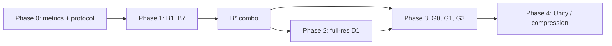

# SplatLab Test Plan v2 (RTX 4500 Ada, 24 GB)

**Status:** approved for planning. Phase 0 is next. Nothing in this plan has been implemented yet.
**Target machine:** office workstation, NVIDIA RTX 4500 Ada Generation (24 GB VRAM, `sm_89`).
**Reference data:** `results/poc_3060ti/` (16-run PoC on the Tanks & Temples `truck` scene, 7k steps, 400k splats).

---

## 1. Findings from the PoC

### What the held-out renders show
Inspected in `splats/poc_3060ti/baseline_gen1/renders/` and `case4a_gen2_anch/renders/` (left = render, right = ground truth):

| Symptom | Where | Likely cause |
|---|---|---|
| Streaky "brush-stroke" trees, buildings and sky | Background | Sparse SfM init (62k points, mostly on the truck), seen from few angles, undertrained |
| Sidewalk is flat grey with no texture | Ground | **Underfitting.** Low-gradient areas get detail last, and 7k steps is about 1/4 of a normal run |
| Street sign and sticker text unreadable; door logo only just readable | Fine detail | Input is only **979×546** (too few pixels on text), made worse by undertraining |
| Smeared edges near the border | Edges | Same as above, plus error from re-encoding H.264 and re-running COLMAP |

The PoC baseline peaked at **0.69 GB of VRAM and took 5 minutes**. Hardware was never the bottleneck.

### Trends
| # | Trend | Evidence |
|---|---|---|
| T1 | Every synthetic generation loses information | Re-render alone costs −1.35 dB. Unanchored generations lose about 1 dB each (23.46 → 20.99 → 19.82 → 18.83) |
| T2 | Real-ESRGAN is worse than no-op and worse than Lanczos | case2 20.99 vs case2b 21.91 vs case1 22.11 dB. LPIPS 0.30 → 0.38 |
| T3 | Real-frame anchoring is the biggest lever in the matrix | +1.7 / +2.55 / +3.20 dB at gen 2 / 3 / 4 |
| T4 | Multi-path gives a small, consistent gain | +0.30 dB (no AI), +0.42 (AI), +0.38 (anchored) |
| T5 | No iterative run beats the baseline | Best is case4a, 23.04 dB vs 23.46. LPIPS 0.297 vs 0.238 |

### Confounders in the PoC matrix
1. **Unequal real-frame budget.** All runs use 7,000 steps. Baseline sees each real frame about 32 times, anchored runs (50% real) only about 16.
2. **The upscaled runs train at 4× the pixels** (1954×1090) with the same steps and cap, but are evaluated at 1×.
3. **Test frames lie on the capture path** (interpolation only). Off-path game-camera distortion is never measured.
4. **Pipeline loss.** The source JPEGs are re-encoded to H.264 4:2:0 and COLMAP is re-run, even though `inputs/_raw/tandt_db.zip` already includes the authors' COLMAP model (`tandt/truck/sparse/0`).

---

## 2. Theories
| ID | Theory | Prediction |
|---|---|---|
| H1 | The baseline is badly undertrained, and that is most of the visible blur | 30k steps plus 1–3M splats gives +1.5–2.5 dB and LPIPS −30–45% (published 3DGS truck: about 25.2 dB / 0.88 / 0.13–0.15) |
| H2 | Self-distillation can't create information | Without a new external signal, no case beats its source on held-out real frames, even with matched compute |
| H3 | Real-ESRGAN is the wrong prior (trained on downsampling and compression, not splat artifacts) | A splat-artifact fixer (Difix3D+) beats both Real-ESRGAN and no-op, especially off-path |
| H4 | Multi-path helps through view coverage, not added detail | Its gain grows on an extrapolation split and stays small on interpolation |
| H5 | Text legibility is limited by pixels on the target | Full-res or close-up input beats any training change at 979 px on OCR accuracy |

## 3. Realistic targets
Held-out PSNR on 979 px truck has about +2.5–3.5 dB of headroom (roughly 2× lower pixel error), and LPIPS about 2× better. "Orders of magnitude" is realistic for **text legibility** (OCR accuracy from about 0–40% to 90%+), **off-path distortion** (no-reference quality / FID), and **effective texture resolution** (2–4× linear with full-res data or input-side video SR).

| Metric | Now | Target |
|---|---|---|
| Held-out PSNR / SSIM / LPIPS (979 px) | 23.46 / 0.810 / 0.238 | about 26 / about 0.89 / about 0.12 |
| OCR character accuracy (door logo, street sign, plate) | about 0–40% (estimate) | 90%+ |
| Off-path no-reference quality / FID | poor | large step change |

---

## 4. Adjustments for a 24 GB RTX 4500 Ada
- **Phases 0–3 all run on this machine.** Nothing waits for the RTX PRO 6000.
- Splat cap up to **3M at 979 px**, and **2M at full res (1957×1091)**. Try 3M at full res only if VRAM allows (check `peak_vram_gb` in `metrics.json`).
- Difix3D+ (SD-Turbo-based, roughly 10–16 GB) and SeedVR2-3B (24 GB with tiling or block swap) fit, but **run them as separate stages**, never alongside training. SeedVR2-7B needs offloading, so treat it as optional.
- Throughput estimate: about 2× the 3060 Ti, so a 30k-step run at 979 px takes roughly 10–20 minutes. Measure the first run and update this estimate.
- Profile: `configs/rtx4500.yaml`. The `rtx6000*.yaml` profiles stay in the repo in case that machine becomes available.

---

## 5. Test plan

### Phase 0: Measurement and protocol (code only, about half a day)
- **M1 Extrapolation split:** hold out a contiguous arc of about 1/8 of the orbit as `test_extrap`, alongside the every-8th-frame `test_interp`.
- **M2 Text legibility:** fixed crops (door logo "SAN PEDRO SQUARE MARKET", "St John" street sign, license plate, tailgate sticker). Run OCR (EasyOCR or PaddleOCR), score character accuracy against ground-truth strings, and save a crop gallery.
- **M3 Off-path perceptual:** 3 fixed off-path orbits (higher, lower, closer), scored with a no-reference metric (MUSIQ / CLIP-IQA via `pyiqa`) plus FID/KID against the real frames.
- **M4 Equal-compute protocol:** train to convergence (30k), or fix the *number of real-frame samples* rather than the step count.
- **M5 Region metrics:** truck vs background PSNR/LPIPS, using a SAM or depth-threshold mask.

### Phase 1: Fix the baseline (one change at a time from B0, then combine into B*)
| Case | Change | Tests | Expected |
|---|---|---|---|
| B0 | Current baseline, re-measured with Phase 0 metrics | reference | – |
| B1 | Original JPEGs + authors' COLMAP model (no H.264, no re-SfM) | pipeline loss | +0.2–0.6 dB |
| B2 | 30k steps | H1 | +1.5–2 dB |
| B3 | 30k steps, cap 1M / 2M / 3M | H1 | +0.3–0.8 dB over B2 |
| B4 | Dense init from COLMAP MVS (`patch_match_stereo` + fusion) | background and ground | lower background LPIPS |
| B5 | Per-image exposure compensation (bilateral grid / per-image affine) | brightness-shift floaters | +0.3–1 dB |
| B6 | Anti-aliased rasterization + Mip-Splatting 3D filter | zoom and off-path distortion | big off-path gain |
| B7 | Monocular depth prior (Depth Anything V2, scale-aligned) | off-path geometry | better extrapolation |
| B* | Best combination | – | about 25.5–26.5 dB, LPIPS about 0.12–0.15 |

Estimated time: about 3–5 GPU-hours for Phase 1.

### Phase 2: More real information
| Case | Change | Tests |
|---|---|---|
| D1 | Full-res T&T truck (about 1920×1080) from tanksandtemples.org with B*. Evaluate at 1× and 2× | H5 |
| D2 | Denser frame sampling, if a source video is available | coverage |
| D3 | User's own capture: 4K, 60 fps, fast shutter, locked exposure and white balance, 3 orbit heights, slow close-up passes on text and details, 500–1500 frames | the real gaming target |

### Phase 3: Generative priors done right
| Case | Change | Tests |
|---|---|---|
| G0 | Re-run case4a under the equal-compute protocol | confounder 1 |
| G1 | **Difix3D+** (nv-tlabs/Difix3D, HF `nvidia/difix`): render off-path views from B*, fix them with Difix using the nearest real frame as reference, add them progressively, always anchored | H3, H4 |
| G2 | G1 plus Difix as a render-time post-filter | gaming display path |
| G3 | Input-side 2× video SR of the *real* frames (SeedVR2-3B / STAR), compared against **real full-res ground truth from D1** | does SR add real detail |
| G4 | Real-ESRGAN version of G1 | control for the prior |

**Gate:** only adopt G1 if it beats B* on M1/M3 with less than 0.2 dB loss on interpolation.

### Phase 4: Gaming robustness
Compression (SPZ / quantization), LOD, Unity FPS/VRAM benchmark (UnityGaussianSplatting), and Phase 0 metrics on in-engine camera paths.

## 6. Open decisions (ask the user before acting)
1. Approval to start Phase 0 + Phase 1.
2. OK to download full-res Tanks & Temples truck (research license)?
3. Is the user shooting their own scene? If yes, write the capture guide early.
